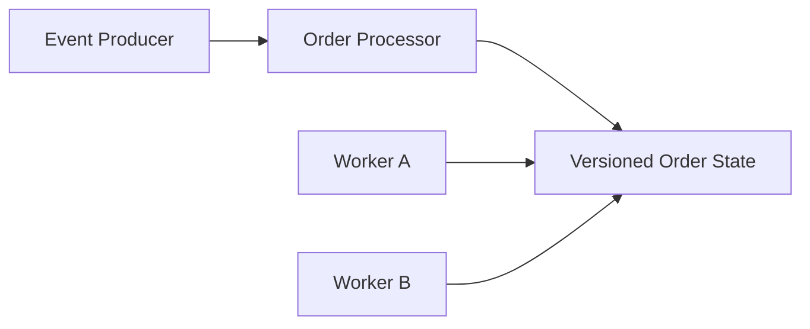
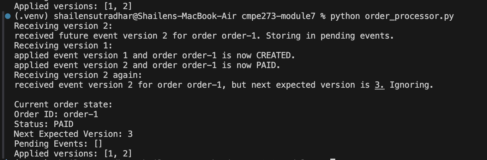
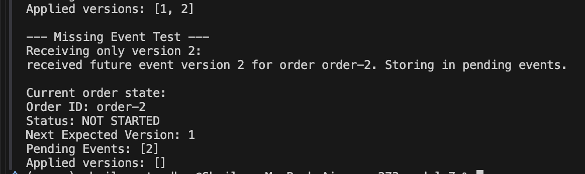
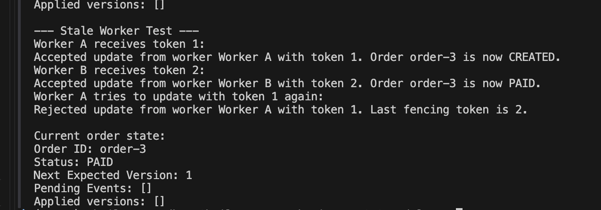

# CMPE 273 Module 7: Time, Ordering & Coordination

This project simulates how a distributed order-processing system handles delayed events, out-of-order delivery, duplicate events, missing events, and stale workers.

The order-processing simulation uses:

- Version numbers for event ordering
- Pending-event storage for missing events
- Fencing tokens to reject stale workers

## Architecture



The event processor accepts order events containing an `order_id`, `version`, and `status`. The order state applies events only when the expected version arrives. Events that arrive too early are stored as pending, while duplicate or stale versions are ignored.

Workers use increasing fencing tokens when updating an order. Once a newer token has been accepted, updates from workers using older tokens are rejected.

## Project Files

```text
.
├── order_processor.py
├── screenshots/
│   ├── 01-versioned-event-ordering.png
│   ├── 02-missing-event.png
│   └── 03-stale-worker-rejection.png
└── README.md
```

## Requirements

- Python 3.9 or newer
- No external Python packages

This project uses only Python's standard library, including `dataclasses`.

## Running the Program

Clone the repository and enter the project directory:

```bash
git clone https://github.com/shailensd/cmpe273-module7.git
cd cmpe273-module7
```

Run the simulation:

```bash
python order_processor.py
```

On some systems, use:

```bash
python3 order_processor.py
```

## Test 1: Versioned Event Ordering

The first test delivers events in this order:

```text
version 2
version 1
version 2 again
```

The expected behavior is:

1. Version 2 is stored as pending because version 1 is missing.
2. Version 1 is applied and changes the order to `CREATED`.
3. The pending version 2 is then applied and changes the order to `PAID`.
4. The duplicate version 2 event is ignored.

The final state is:

```text
Status: PAID
Next Expected Version: 3
Pending Events: []
Applied versions: [1, 2]
```



This demonstrates that events are applied in version order even when they arrive out of order. It also demonstrates that duplicate events do not apply a second time.

## Test 2: Missing Event

The second test sends only version 2:

```text
version 2
```

Because version 1 has not arrived, the order does not move to `PAID`. Instead, version 2 is stored as a pending event.

Expected state:

```text
Status: NOT_STARTED
Next Expected Version: 1
Pending Events: [2]
Applied versions: []
```



This demonstrates that the processor detects the missing earlier version and prevents the order from incorrectly jumping ahead.

## Test 3: Stale Worker Rejection

The stale-worker test uses fencing tokens:

```text
Worker A → token 1
Worker B → token 2
Worker A → token 1 again
```

Worker A's first update is accepted:

```text
Token 1 → CREATED
```

Worker B receives the newer token and updates the order:

```text
Token 2 → PAID
```

When Worker A later attempts another update using the old token, the update is rejected:

```text
Rejected update from worker Worker A with token 1.
Last fencing token is 2.
```



The final order status remains:

```text
Status: PAID
Last Fencing Token: 2
```

This demonstrates that an older worker cannot overwrite a newer worker's update.

## Implementation Details

### Version ordering

Each order tracks the next version it expects:

```text
Expected version = 1
```

If a received event has a version greater than the expected version, it is stored in `pending_events`.

If the received event has the expected version, it is applied immediately. After applying it, the processor checks whether the next expected version is already pending.

### Duplicate handling

If an event's version is lower than the next expected version, the event has already been processed or is stale. The processor ignores it.

For example:

```text
Next expected version = 3
Received version = 2
Result = ignored
```

### Fencing tokens

The order tracks the most recently accepted fencing token.

An update is accepted only when its token is newer than the current token. An update using an older or equal token is rejected.

This protects the order from stale workers that continue running after another worker has taken ownership.

## Reflection

Timestamps alone are not enough to guarantee correct event ordering because distributed machines may have unsynchronized clocks and messages may experience different network delays. A message with an earlier timestamp can arrive after a message with a later timestamp. Clock values also do not reliably represent the causal relationship between events on different machines. Version numbers, logical clocks, sequence numbers, or other coordination mechanisms are needed to determine the correct processing order.

## Conclusion

This project demonstrates three common distributed-systems coordination techniques:

- Version numbers prevent incorrect event ordering.
- Pending events allow the system to wait for missing updates.
- Fencing tokens prevent stale workers from overwriting newer updates.